# Fullpad

Editor de notas e markdown **rápido**, no estilo do Notepad++: **nada se perde ao fechar**. O markdown é renderizado e continua editável (*live preview*), e cada tipo de arquivo ganha a visão que faz sentido para ele: tabela para CSV, árvore para JSON/YAML/TOML, diagrama para DBML e Mermaid, equações para LaTeX, leitor para PDF e EPUB.

[**⬇ Baixar a última versão**](https://github.com/Brennon-Oliveira/fullpad-releases/releases/latest) · Windows 10/11 · gratuito e de código aberto (MIT)


## Sumário

- [Baixar e instalar](#baixar-e-instalar)
- [Por que o Fullpad](#por-que-o-fullpad)
- [Cada tipo de arquivo, a sua visão](#cada-tipo-de-arquivo-a-sua-visão)
- [Todos os recursos](#todos-os-recursos)
- [Contribuir e relatar problemas](#contribuir-e-relatar-problemas)
- [Licença](#licença)

## Baixar e instalar

**Windows 10/11**: baixe o instalador `Fullpad_<versão>_x64-setup.exe` na [última versão](https://github.com/Brennon-Oliveira/fullpad-releases/releases/latest) e execute. A instalação é por usuário (não pede administrador) e, no instalador, você escolhe se quer abrir arquivos `.md` e `.dbml` por padrão com o Fullpad e se quer vê-lo no "Abrir com" dos arquivos de texto. Depois de instalado, o app **se atualiza sozinho**: ele avisa quando há versão nova, grava tudo e instala.

> **Aviso do SmartScreen.** O instalador **não tem assinatura de código do Windows** (isso custa um certificado pago), então na primeira execução o Windows mostra "O Windows protegeu o computador / editor desconhecido". Clique em **Mais informações → Executar assim mesmo**. As atualizações automáticas, essas sim, são assinadas por uma chave própria do projeto, e o app só aceita as que conferem.

**Linux** e **macOS**: ainda não há instalador.

**Suas notas ficam com você**: os dados do Fullpad ficam em `%APPDATA%\fullpad`, fora da pasta do programa, então **desinstalar não apaga as suas notas**.

## Por que o Fullpad

- **Nada se perde.** O texto de cada aba é guardado enquanto você digita; fechar o app, uma queda de energia ou fechar uma aba sem querer não leva nada. Abas, janelas, painéis, posição do cursor e do leitor voltam como estavam.
- **Abre rápido e fica leve.** Os recursos pesados (diagramas, equações, leitor de PDF) só são carregados quando o primeiro arquivo que precisa deles aparece.
- **O texto é sempre texto puro.** Renderizar markdown, mostrar uma tabela ou um diagrama nunca reescreve o seu arquivo: a visão é uma máscara sobre o documento.
- **Seus arquivos estão seguros.** Toda gravação é atômica, preserva codificação e quebras de linha, e nunca sobrescreve uma mudança feita por outro programa sem perguntar.
- **Abre arquivo de qualquer origem sem susto.** PDF, EPUB e Markdown abrem sem executar scripts e sem acessar a rede.

## Cada tipo de arquivo, a sua visão

| Tipo | O que você vê |
|---|---|
| **Markdown** (`.md`) | Texto renderizado e editável no próprio lugar, barra de formatação sobre a seleção, tabelas, equações, diagramas Mermaid, sumário lateral, exportar HTML/PDF |
| **CSV / TSV** | Tabela com ordenação, filtro, estatísticas da seleção e edição de célula, ligada ao código |
| **JSON** (`.json`, `.jsonc`, `.geojson`) | Árvore ao lado do código, formatar/minificar, links, cores e miniaturas de imagem |
| **YAML / TOML** | Árvore ao lado do código, com validação |
| **DBML** | Diagrama das tabelas e relações ao lado do código, com zoom e exportar SVG/PNG |
| **Mermaid** (`.mmd`) | Diagrama ao lado do código, com zoom e exportar SVG |
| **LaTeX** (`.tex`) | As equações soltas do arquivo, uma por cartão, ligadas ao código |
| **PDF** | Leitor com zoom, busca, citação em markdown e posição de leitura lembrada |
| **EPUB** | Leitor com sumário, capítulo limpo, busca e citação |
| **Código** (Python, Rust, SQL, JS/TS, Shell, C#, Go...) | Destaque de sintaxe para dezenas de linguagens |

### Markdown, o carro-chefe

O markdown é renderizado no próprio texto: você edita o que está vendo. Selecione um trecho e a barra de formatação aparece sobre ele (tipo de bloco, negrito, itálico, tachado, código, equação, link, limpar). Tabelas, equações `$...$` e `$$...$$` e blocos ` ```mermaid ` viram desenho, e com o cursor sobre eles aparece o código.

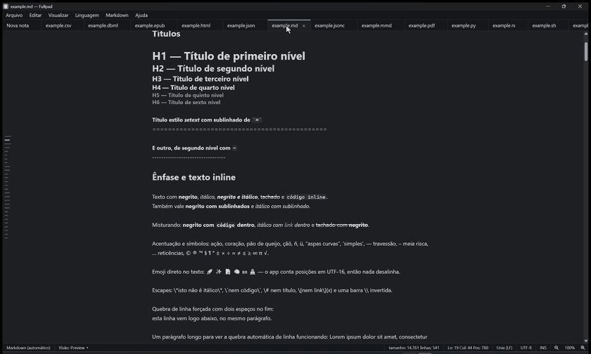

Alterne entre **só o preview**, **só o código** e **código e preview lado a lado**, e mantenha o **sumário lateral** aberto ou deixe-o como barrinhas na borda. Exporte para **HTML** autônomo, **PDF** (sem o cabeçalho e o rodapé do navegador) ou copie como HTML para colar em outro lugar.

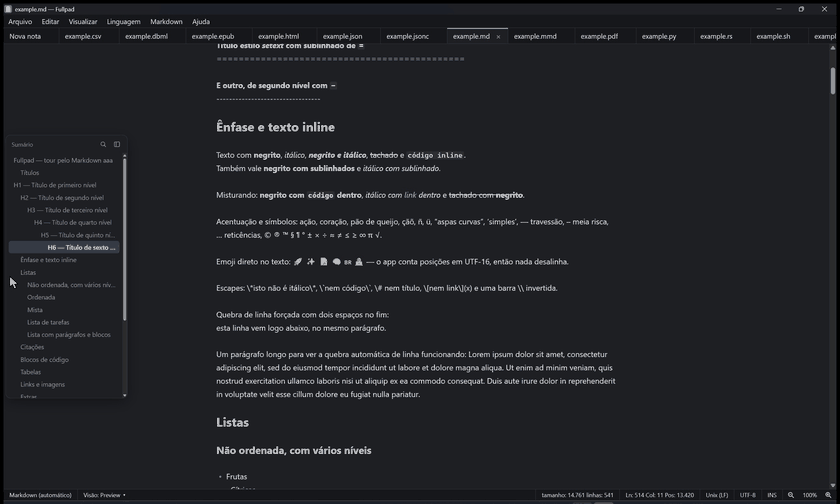

As exportações ficam em Arquivo > Exportar, no menu Markdown e no botão direito sobre o conteúdo:

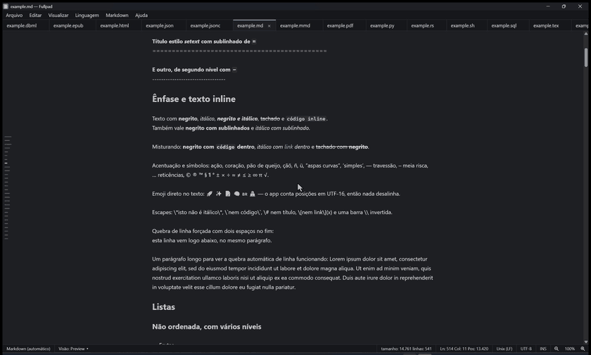

### Tabelas de verdade: CSV

A tabela carrega só as linhas que estão na tela, então arquivos grandes abrem na hora. Clique no cabeçalho para ordenar, filtre por uma coluna ou por todas, selecione células para ver soma, média, mínimo, máximo e contagem no rodapé, edite célula por célula (Ctrl+Z desfaz, como no texto) e cole direto do Excel. O cursor do código e a célula da tabela andam juntos.

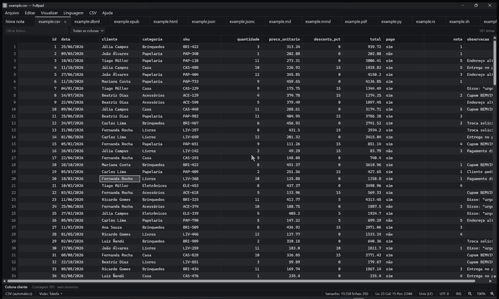

### JSON, YAML e TOML em árvore

A árvore fica ao lado do código; passar o mouse num nó pinta o trecho no código e mover o cursor no código acende o nó. No JSON, números enormes e chaves repetidas ficam como estão, e formatar é um só passo no Ctrl+Z.

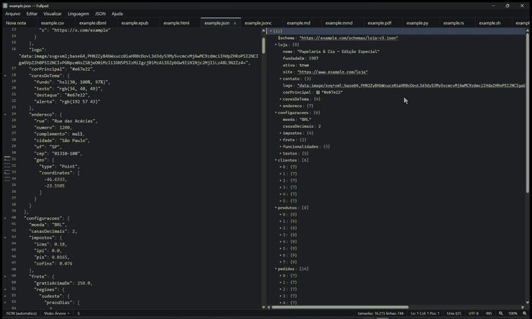

### Diagramas: DBML e Mermaid

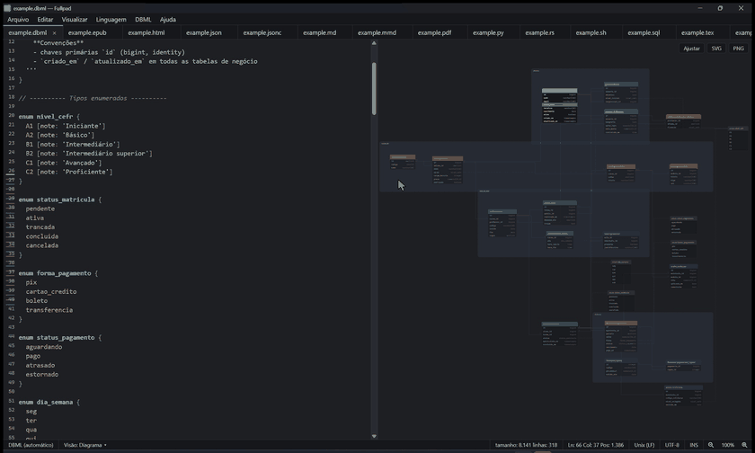

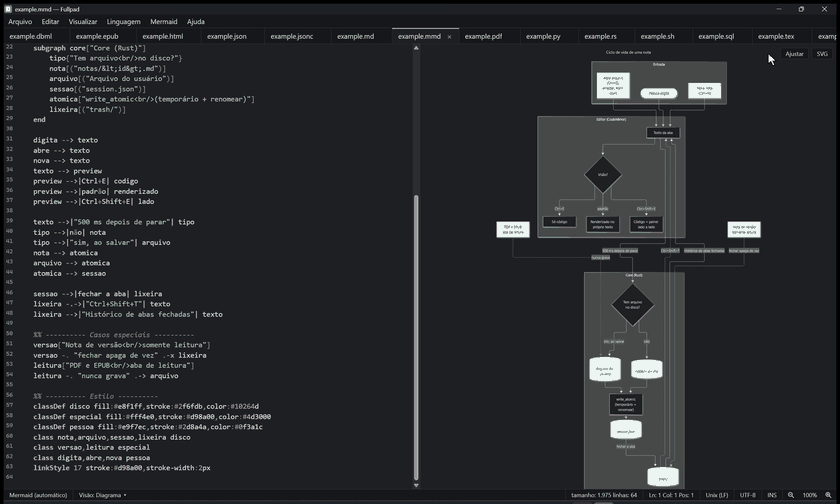

### Equações: LaTeX

O Fullpad não compila documentos LaTeX: ele mostra **as equações** do arquivo, uma por cartão. Passar o mouse no cartão pinta o trecho no código e clicar leva o cursor até lá.

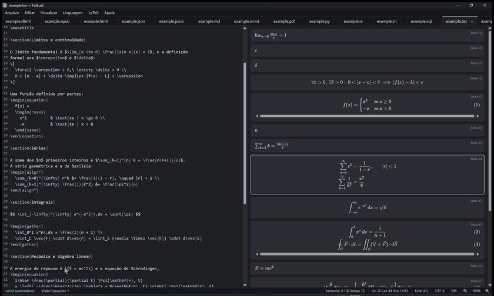

### Leitura: PDF e EPUB

Abas de leitura **nunca gravam no arquivo**. O PDF e o EPUB abrem sem scripts e sem rede, lembram onde você parou (mesmo que o arquivo mude de lugar), têm busca no documento e "Copiar como citação", que já leva o título e a página ou o capítulo.

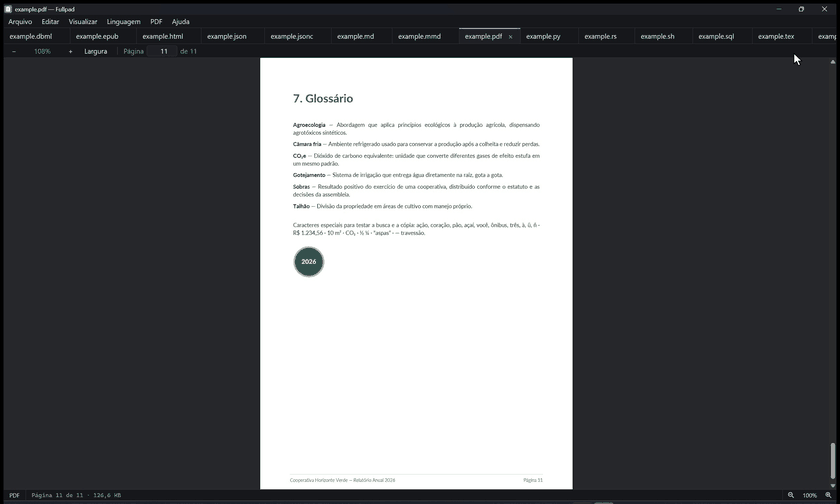

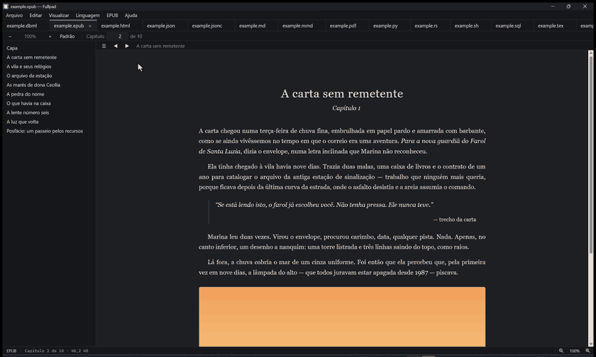

### Painéis e janelas

Divida a janela em painéis, lado a lado ou empilhados, como no VS Code. Ao arrastar uma aba aparecem **alvos visíveis** para soltar: uma borda divide o painel, o centro de outro painel move a aba para lá, e soltar fora da janela cria uma janela nova.

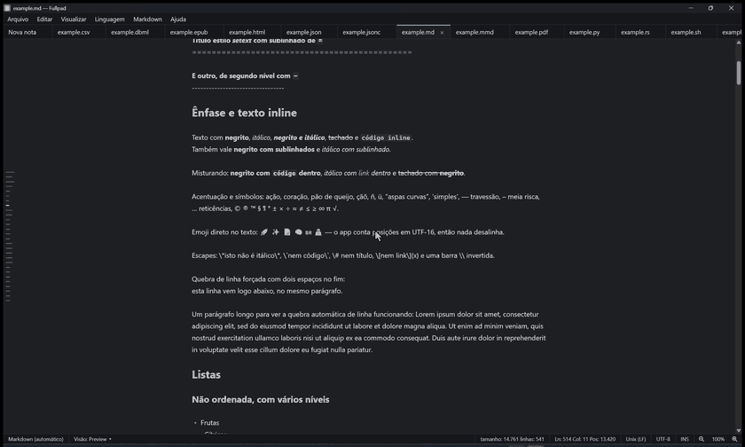

Os **alvos azuis** mostram, antes de soltar, onde a aba vai cair: o painel inteiro (para mover a aba para ele), o lado ou a base de um painel (para dividi-lo) e as barras da borda externa (para dividir o bloco todo):

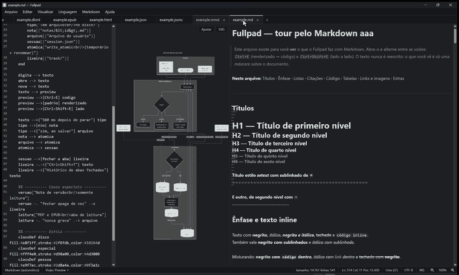

### Achar qualquer coisa

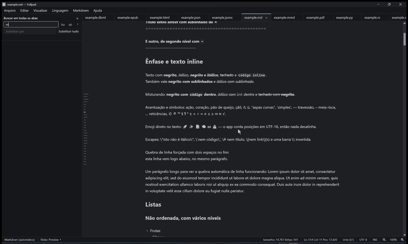

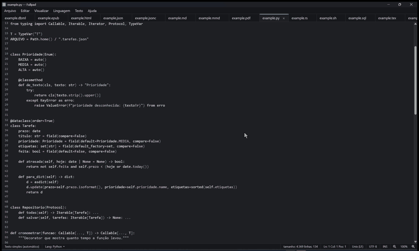

## Todos os recursos

### Nada se perde

- Cada aba é guardada **enquanto você digita** e a sessão inteira (abas, janelas, painéis, cursor, visão de cada arquivo) volta ao reabrir o app.
- **Notas soltas**: abas que não pertencem a nenhum arquivo, só ao Fullpad. Fechar uma nota a move para a lixeira em vez de apagar.
- **Reabrir aba fechada**: Ctrl+Shift+T reabre a última; Ctrl+Shift+H abre o **histórico de abas fechadas**, com filtro, trazendo de volta título, arquivo, linguagem e visão.
- **Gravação atômica**: toda gravação passa por um arquivo temporário e uma troca; um travamento no meio nunca corrompe a nota nem o seu arquivo. Uma sessão corrompida não impede o app de abrir (ela é guardada à parte e o app recomeça).

### Arquivos de verdade

- **Preserva codificação** (UTF-8, UTF-8 com BOM, CP1252) e **quebras de linha** (CRLF/LF) ao salvar.
- **Arquivo alterado fora do Fullpad**: se a aba não tem alterações, ela se **recarrega sozinha** (e o Ctrl+Z traz o texto de antes); se tem, uma faixa pergunta "Recarregar do disco" ou "Manter o meu"; se o arquivo sumiu, avisa e o texto fica na aba. **Salvar nunca sobrescreve uma mudança externa sem perguntar** (Sobrescrever, Salvar como… ou Cancelar). F5 e Ctrl+R recarregam do disco.
- **Abrir de todo jeito**: Ctrl+O, "Abrir com" do Windows, duplo clique, linha de comando, segunda instância (que entrega o arquivo à janela já aberta) e **arrastar arquivos do Explorer** para a janela.
- **Salvar todos** (Ctrl+Alt+S) e **fechar em lote** (outras, todas, só as salvas), com uma única pergunta se houver alterações.
- **Instância única**: abrir o Fullpad de novo (ou um arquivo "com" ele) entrega os arquivos à janela que já está aberta, em vez de abrir outro app.

### Abas, janelas e painéis

- **Abas**: reordene arrastando; **fixe** abas (um alfinete no lugar do ×, ficam à esquerda e protegidas de fechar em lote); botão do meio fecha; a roda rola a barra na horizontal.
- **Várias janelas**: tire uma aba da janela arrastando (uma "sombra" com o nome segue o ponteiro e a janela nova aparece na hora) ou use o menu; mova abas entre janelas pela barra de abas de outra janela. Janelas flutuantes voltam na posição em que ficaram.
- **Painéis**: divida à direita (Ctrl+\\) ou abaixo (Ctrl+Shift+\\); arraste uma aba para um dos **alvos visíveis** (borda do painel, borda do bloco inteiro, centro de outro painel); cada divisa tem um menu (inverter os lados, alternar entre lado a lado e empilhado, dividir igualmente) e arrasta para redimensionar. Cada painel tem editor, abas e visões próprios.
- **Visão em janela separada**: o preview do markdown, o diagrama ou as equações numa janela só, acompanhando o texto.

### Editor

- **Destaque de sintaxe** para JS, TS, JSON, SQL, Python, CSS, HTML, Rust, YAML, Shell, C#, C, C++, Java, Kotlin, Go, Ruby, TOML, PowerShell, Dockerfile, Lua, Perl, Swift, Diff, INI, XML e DBML. Em arquivos de texto puro, o botão **Lang** do rodapé troca o destaque à mão.
- **Localizar e substituir** em todo editor: contador "3 de 12", anterior/próximo, maiúsculas, palavra inteira, **regex**, substituir um ou todos.
- **Busca global** (Ctrl+Shift+F) em todas as abas da janela, com os mesmos filtros, resultados agrupados por aba e **Substituir tudo** (com confirmação, e um Ctrl+Z por aba).
- **Paleta de um campo só** (Ctrl+P): arquivos abertos, fechados e recentes; `arquivo:42` abre já na linha; `:` vai à linha (Ctrl+G); `@` lista os títulos e símbolos do arquivo (Ctrl+Shift+O); `>` lista **todos os comandos dos menus** com atalho (Ctrl+Shift+P). A busca é aproximada: sem maiúsculas nem acentos.
- **Sumário lateral** (estilo Notion): barrinhas na borda que viram um cartão ao passar o mouse; dá para manter aberto, escolher o lado e **buscar dentro do sumário**. Vale para Markdown, DBML, JSON, YAML e TOML.
- **Números de linha**, quebra de linha, **zoom da janela inteira** (25% a 500%, Ctrl+roda, Ctrl+= e Ctrl+-, controle no rodapé), **tema claro e escuro**.
- **Links clicáveis** em qualquer arquivo (duplo clique ou Ctrl+clique abre no navegador; botão direito copia o link).
- **Menu do tipo de arquivo**: o menu ao lado de "Linguagem" muda conforme a aba (JSON, CSV, Markdown, DBML, Mermaid, LaTeX, PDF/EPUB, Texto), com as ações daquele tipo.
- **Barra de status**: linguagem, visão, tamanho e linhas, linha e coluna, quebra de linha, codificação, zoom.

### Markdown

- **Live preview** editável: títulos, ênfase, listas, tarefas, citações, código com destaque por linguagem, links, imagens, tabelas e o resto do markdown renderizados no texto.
- **Barra de formatação** sobre a seleção (estilo Notion) e em Markdown > Formatar: tipo de bloco (texto, títulos 1 a 3, lista, numerada, tarefas, citação, código), **negrito, itálico, tachado, código, equação, link** e limpar formatação; Ctrl+B, Ctrl+I, Ctrl+K, Ctrl+Shift+X e Ctrl+Shift+M; cada ação é um passo no Ctrl+Z.
- **Equações LaTeX** (`$...$` e `$$...$$`, sem rede e sem links) e **diagramas Mermaid** em blocos de código, desenhados no texto.
- **Três visões**: renderizado no próprio texto, só código e lado a lado (Ctrl+E e Ctrl+Shift+E), ou o preview numa janela separada.
- **Exportar**: HTML autônomo (fontes das equações incluídas), PDF pela impressão do sistema e "copiar como HTML".

### Dados

- **JSON** (`.json`, `.jsonc`, `.geojson`, `.webmanifest`): árvore ao lado do código; validação com o erro sublinhado e linha/coluna; **formatar** (indentação 2, 4 ou tab, minificar, ordenar chaves; Alt+Shift+F) sem perder números enormes nem chaves repetidas; comentários e vírgula sobrando aceitos em `.jsonc`; links clicáveis, **cores** e **miniaturas de imagem** nos valores; copiar o caminho de um nó (`$.lista[0].nome`); o código e a árvore andam juntos.
- **YAML** e **TOML**: a mesma árvore, com validação, vários documentos YAML (`---`) e datas do TOML, sem reescrever o seu texto.
- **CSV e TSV**: detecção automática do **separador** (ou escolha manual, que é lembrada), cabeçalho e **decimal** configuráveis, colunas coloridas no código; na tabela, ordenar (como número ou como texto sem acento), filtrar, selecionar células com **estatísticas**, editar célula, colar do Excel, **inserir, apagar e mover linhas e colunas**, renomear o cabeçalho, ordenar o arquivo por uma coluna, copiar como TSV, ajustar a altura de cada linha e abrir o texto inteiro de uma célula cortada. Só as células editadas mudam no arquivo.
- **DBML**: diagrama das tabelas e relações, com diagnóstico de erros, autocompletar, **zoom e arrastar**, "Ajustar", exportar SVG e PNG, e ligação com o código (passar o mouse pinta a linha, o cursor acende o elemento).
- **Mermaid** (`.mmd`, `.mermaid`) e **LaTeX** (`.tex`): o diagrama ou as equações sempre ao lado do código.

### Leitura (PDF e EPUB)

- **Abrir não carrega**: a aba mostra o nome e o tamanho e só lê o arquivo quando você pede. Antes, o PDF passa por uma verificação contra **bombas de compressão**.
- **PDF**: páginas desenhadas só quando aparecem, texto selecionável, links, zoom, página atual.
- **EPUB**: sumário (EPUB 2 e 3), capítulo limpo, tamanho do texto de 60% a 300%, tema claro e escuro.
- **Busca no documento** (Ctrl+F) sem maiúsculas nem acentos, com o resultado realçado e "3 de 17".
- **Copiar como citação** (Ctrl+Shift+C): um bloco markdown com o trecho e a origem (título, página ou capítulo).
- **Posição de leitura por arquivo**: lembrada pelo conteúdo, então mover ou renomear o arquivo não a perde. Arquivo ausente: "Localizar arquivo…". Arquivo alterado: faixa "Recarregar".
- Nunca grava no arquivo, não executa o JavaScript do PDF, abre links só `http`, `https` e `mailto`.

### Instalação e sistema

- **Instalador Windows por usuário** (não pede administrador), em português, com integração opcional: abrir `.md`, `.markdown`, `.dbml` e `.dbmlx` por padrão com o Fullpad e mostrá-lo no "Abrir com" dos arquivos de texto.
- **Atualização automática assinada**: o app procura versão nova ao abrir (e em Ajuda), grava tudo antes de instalar e, depois de atualizar, abre a **nota de versão**; Ajuda > "Histórico de versões" mostra todas.
- **Dados** em `%APPDATA%\fullpad`, fora do instalador: desinstalar não apaga as suas notas.

## Contribuir e relatar problemas

O Fullpad é de código aberto. O código, as issues e o guia de contribuição estão em **[github.com/Brennon-Oliveira/fullpad](https://github.com/Brennon-Oliveira/fullpad)**: lá você pode relatar um bug, sugerir uma ideia ou contribuir. Este repositório só guarda os instaladores de cada versão.

## Licença

O Fullpad é distribuído sob a licença **MIT** (veja [`LICENSE`](LICENSE)). O instalador traz, na pasta de instalação, a licença e os avisos de licença das bibliotecas de terceiros que o Fullpad usa.
